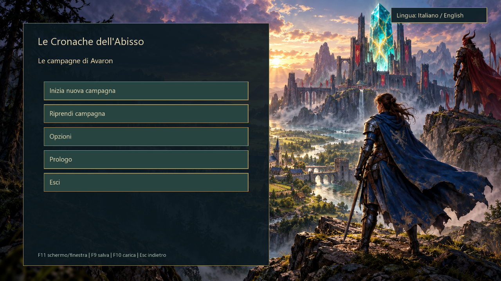
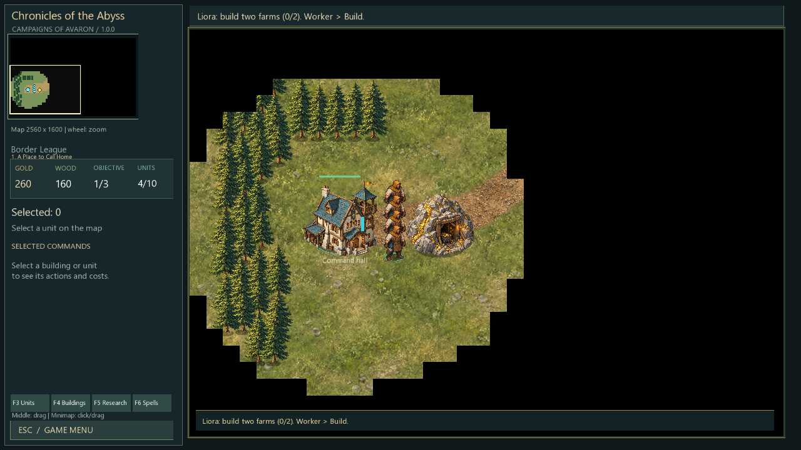

# Le Cronache dell’Abisso — Chronicles of the Abyss

A single-player fantasy real-time strategy game for Windows, written in C++17 with SFML.
**Version 1.0.0 · Italiano / English · Human and Dark Kin factions · Offline play**



## Download and play

Go to the [v1.0.0 release](https://github.com/SboMusic/le-cronache-dell-abisso/releases/tag/v1.0.0):

| Download | Use |
| --- | --- |
| `Chronicles-of-the-Abyss-1.0.0-Windows-Setup.exe` | Windows installer; recommended for players |
| `Chronicles-of-the-Abyss-1.0.0-Windows-Portable.zip` | Extract, then run `Frontiere/Frontiere.exe` without installation |
| `Chronicles-of-the-Abyss-1.0.0-Source.zip` | Complete corresponding source, original artwork, dependencies and build scripts |
| `SHA256SUMS.txt` | Checksums for all three downloads |

Windows 10/11, mouse and keyboard. No account or Internet connection is required to play.
The game is a 32-bit Windows application and also runs on 64-bit Windows.
The installer runs per user without requiring administrator privileges. It is not digitally signed.
Developers can instead clone this repository; GitHub’s automatic source archives contain source, not a ready-to-run game.

## What is included

- Ten campaign missions and a separate final war, across eleven maps.
- Human and Dark Kin armies, original unit/building artwork and faction-specific casters.
- Workers, finite gold mines and individual harvestable trees, farms and population limits.
- Construction, building upgrades, research, land/air/naval combat, spells and transports.
- Exploration, minimap navigation, zoom and middle-button camera dragging.
- Multiple independent campaigns, manual saves, autosaves and support for earlier save formats.
- Italian and English interface, briefings, objectives and player guides.

**Campaign scope:** the human campaign is the original story progression. The Dark Kin variant reuses
its eleven maps and main objectives, with adapted introductions, armies, opposing faction and caster
requirements. A separate Dark Kin story with exclusive maps is not included in 1.0.0.
The release is single-player; it does not include multiplayer, a map editor, music or voice acting.



## Quick start

Choose **Start new campaign**, pick Humans or Dark Kin, read the briefing and start the mission.
**Continue campaign** lists your saved campaigns by faction, mission and date.
**Options** changes language and fullscreen/windowed mode; **Prologue** starts the guided introduction.

| Control | Action |
| --- | --- |
| Left-click / drag | Select a unit / select a group |
| Right-click | Move, gather, attack or repair, depending on target |
| Middle button + drag | Move the camera |
| WASD / arrows, mouse wheel | Move camera, zoom |
| Minimap click / drag | Jump or pan to a location |
| F3–F6 | Unit, building, research and spell catalogs |
| Esc, P | Game menu, pause |
| F9 / F10 | Manual campaign save / load |
| F11 or Alt+Enter | Fullscreen / windowed |

See the [English player guide](documentazione/GUIDE-ENGLISH.txt) and [guida italiana](documentazione/GUIDA-GIOCO.txt).
Saves and settings live in `%LOCALAPPDATA%/Frontiere`; each new campaign has its own `campagne/<id>` folder.
Updating or uninstalling the game does not remove player saves. Back up that folder to preserve your campaigns.

## Build and contribute

Install Visual Studio 2022 with Desktop development with C++, **MSVC v142 x86/x64** and a Windows SDK.
Then run from the repository root:

```powershell
powershell -NoProfile -ExecutionPolicy Bypass -File strumenti/Compila.ps1
powershell -NoProfile -ExecutionPolicy Bypass -File strumenti/Verifica.ps1
```

The first command creates `gioco/Frontiere.exe` with its runtime assets. The second runs the model
and native interface tests. Model-only tests can run with `strumenti/Verifica.ps1 -SoloSimulazione`.
SFML headers, import libraries, runtime DLLs and official SFML source are included.
Visual Studio and Inno Setup themselves are not bundled.

See [developer setup](documentazione/DEVELOPMENT.md), [architecture](documentazione/ARCHITECTURE.md),
[contribution guidelines](CONTRIBUTING.md), [release notes](documentazione/RELEASE-1.0.0.md) and [changelog](CHANGELOG.md).
GitHub Actions builds the Windows application and runs simulation tests on changes.

## Italiano

La versione **1.0.0** include il gioco Windows, dieci missioni più la battaglia finale, due stirpi,
interfaccia italiana/inglese e più campagne salvate separatamente.
Scarica l’installer dalla [pagina della release](https://github.com/SboMusic/le-cronache-dell-abisso/releases/tag/v1.0.0), oppure estrai la versione portatile.
La variante oscura riutilizza mappe e obiettivi principali della campagna umana; non è ancora una storia
indipendente con mappe esclusive. Il gioco è per un giocatore e funziona senza Internet.
La [guida italiana](documentazione/GUIDA-GIOCO.txt) spiega comandi, strutture, missioni e salvataggi.

## License and credits

The modified game code is distributed under [GNU GPL v3](LICENSE), retaining upstream notices.
The engine includes modified code derived from [lori2001/Warcraft-II-HD](https://github.com/lori2001/Warcraft-II-HD)
and NGin by Szoke Lorand. This is a separate, modified game, not the upstream project or a Blizzard product.
No Blizzard game artwork, sounds, maps or fonts are included in this distribution.
The original bitmap artwork was generated with AI tools; the generation prompts are included in `grafica/`.
Dependencies and Microsoft runtime files retain their own licenses; see [third-party notices](THIRD_PARTY_NOTICES.md).
