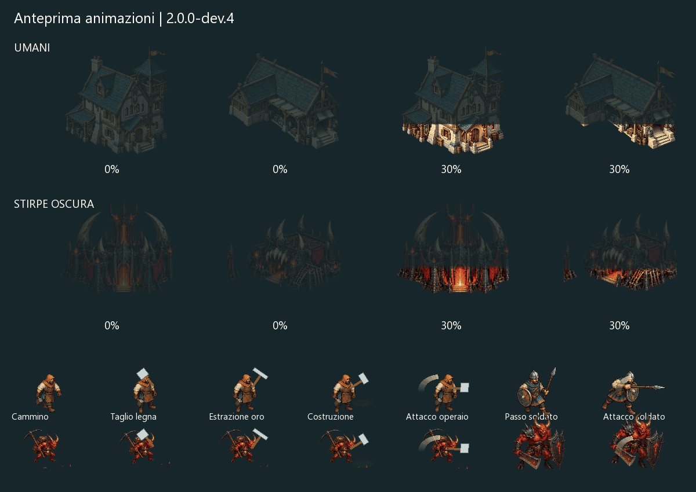

# Animazioni e costruzione progressiva — 2.0.0-dev.4

Gli edifici iniziano come sagome al 19% di opacità. La parte costruita si colora dal basso verso il tetto con un margine sfumato; il riempimento segue il tempo di lavoro reale, interpolato fra gli aggiornamenti della simulazione. Se il cantiere si ferma, il colore non prosegue da solo. Al completamento l’edificio è interamente visibile. Stesso effetto per tutte le strutture di entrambe le fazioni, comprese quelle navali; alberi in crescita e risorse mantengono la propria rappresentazione.

Operai e imp hanno sollevamento dell’attrezzo, colpo rapido e recupero, con ritmi distinti per legna, miniera, costruzione e riparazione. L’utensile viene disegnato una sola volta sulla posa di base. Spalle, busto e parte inferiore della figura ricevono piccoli movimenti continui. Rimangono carichi visibili, schegge, particelle e polvere. Il combattimento dei lavoratori segue il tempo effettivo del colpo, anche con rapidità aumentata.

Per i soldati il ciclo del passo dipende dalla distanza percorsa e si arresta quando l’unità si ferma. Le pose esistenti si accompagnano a movimento delle gambe e del busto. Gli attacchi hanno affondo verso il bersaglio, posa di impatto e recupero, con scia breve anziché un arco sempre acceso durante tutta la ricarica. Il colpo visivo parte quando la simulazione infligge il danno; nessuna modifica a danni, costi, portata o cadenza. Le unità oscure ricevono movimenti procedurali sull’artwork esistente; non sono state create nuove serie complete di sprite bitmap.

I salvataggi non cambiano formato. Gli effetti si applicano anche riprendendo una campagna esistente della copia 2.0; non occorre ricominciare per queste sole animazioni. Le mappe ricostruite della dev.3 restano legate al mondo salvato.

## Verifiche

Prove sul framebuffer nativo controllano la crescita dei pixel solidi per gli artwork degli edifici di entrambe le fazioni, l’arresto e la ripresa del riempimento, la scomparsa della trasparenza a lavori finiti, le azioni di operai e soldati, l’assenza di marcia sul posto e il limite temporale della scia d’attacco. Sono affiancate dalle regressioni di gioco e interfaccia. I quadri dimostrativi sono fixture grafiche controllate, non screenshot di una partita reale.

Il test grafico produce i fotogrammi dimostrativi solo con FRONTIERE_ANIMATION_CAPTURE=1 insieme a FRONTIERE_GRAPHICS_TEST=1; il gioco normale non scrive sequenze di immagini.

[Fotogramma statico](animazioni-dev4.png) · [Rapporto verifiche](VERIFICA-ANIMAZIONI-004.json).
