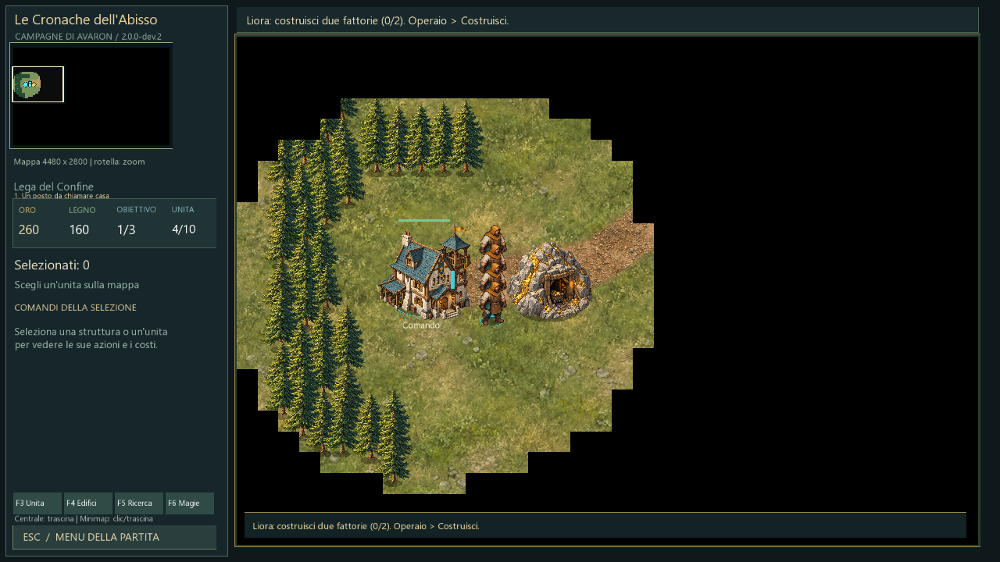

# Mappe progressive — 2.0.0-dev.2

Documento storico dev.2: i layout sono sostituiti da [MAPPE-RICOSTRUITE.md](MAPPE-RICOSTRUITE.md) nella dev.3; le dimensioni restano valide.

Dimensioni effettive delle nuove partite. I salvataggi mantengono la propria disposizione: ricominciare la missione o creare una nuova campagna per applicare la generazione aggiornata.

| Missione | Larghezza | Altezza |
| --- | --- | --- |
| 1 | 4480 | 2800 |
| 2 | 4800 | 3000 |
| 3 | 5120 | 3200 |
| 4 | 5440 | 3400 |
| 5 | 5760 | 3600 |
| 6 | 6080 | 3800 |
| 7 | 6400 | 4000 |
| 8 | 6720 | 4200 |
| 9 | 7040 | 4400 |
| 10 | 7360 | 4600 |
| Finale | 7680 | 4800 |

La prima missione supera la superficie massima delle mappe 1.0 di circa il 36%; il finale arriva a quattro volte quella superficie. Ogni missione aumenta entrambe le dimensioni.

La generazione mantiene gli obiettivi militari avanzati esistenti, aggiungendo riserve finite, foreste regionali, percorsi e territori costieri nelle missioni navali. Non è ancora la riscrittura narrativa e tattica di tutte le missioni. Il villaggio della prima missione è invece riposizionato nella parte orientale della nuova mappa.

Le fattorie aumentano la popolazione: non sono un requisito aggiuntivo quando i posti iniziali sono liberi. Gli obiettivi restano condizioni di vittoria e non impediscono di raccogliere o reclutare unità già sbloccate. Restano costi, limiti di popolazione e progressione tecnologica fra missioni.

Gli accessi iniziali sono liberati dagli alberi troppo vicini a edifici e lavoratori. Per gli operai già in una casella bloccata è consentito uscirne verso il primo punto libero del percorso. Questo non consente di attraversare normalmente foreste o strutture.

