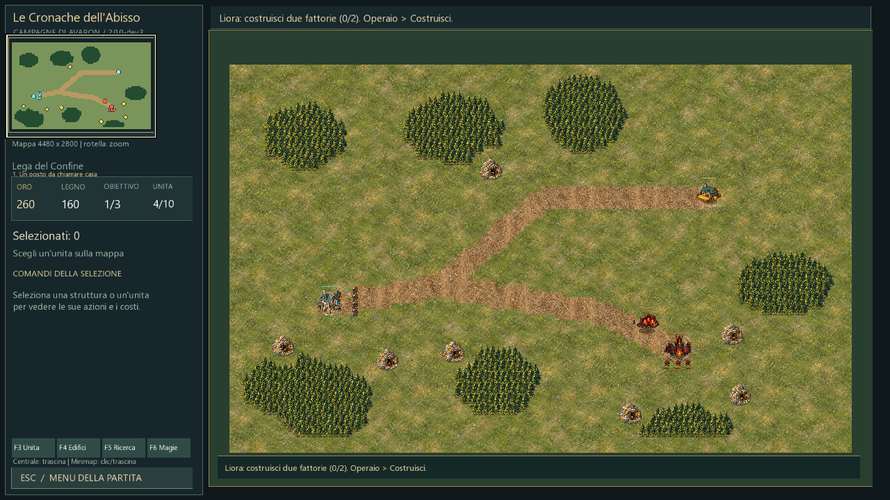
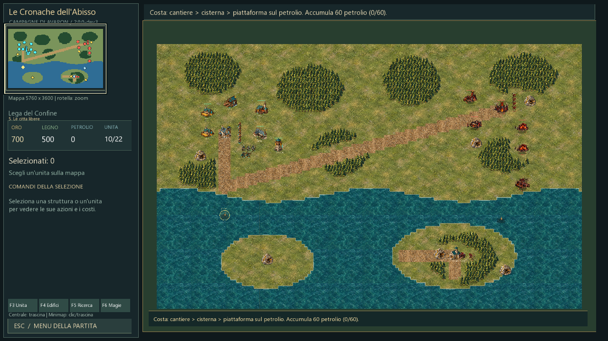
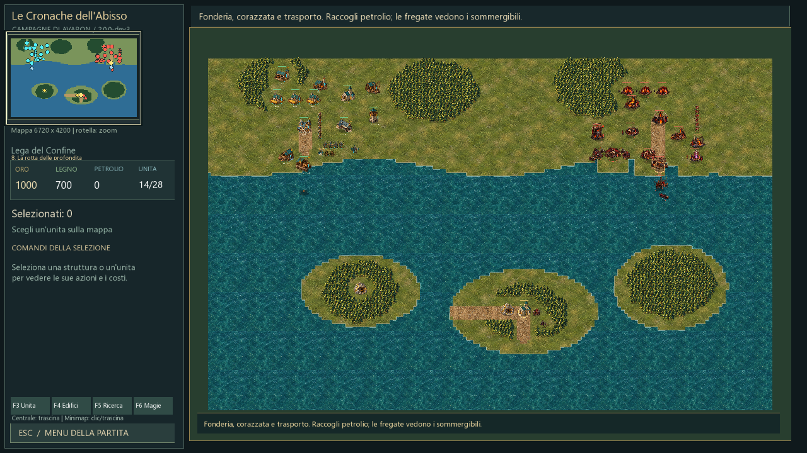
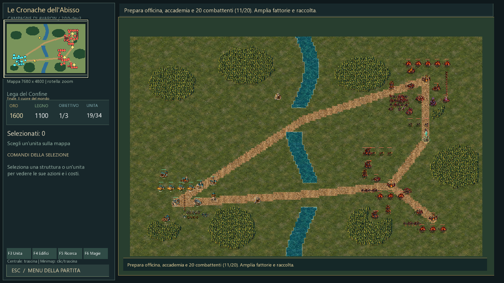

# Mappe ricostruite e lavoratori — 2.0.0-dev.3

Aggiornamento del 21 ottobre 2026. Sostituisce la generazione per estensione della dev.2 nelle nuove partite. In ogni livello vengono rigenerati tutto il terreno, le foreste, gli insediamenti, le riserve e i percorsi. Le unità iniziali e i requisiti tecnologici derivano ancora dal roster della campagna: la nuova disposizione non introduce soldati o tecnologie prematuramente.

## Identità dei livelli

| Livello | Regione | Organizzazione |
| --- | --- | --- |
| 1 | Valle dei Mulini | Base a sud-ovest, villaggio a nord-est e bivio verso un campo di lavoratori rivali a sud-est. Nessun soldato, scontro facoltativo. |
| 2 | Passo delle Sentinelle | Strada a tornanti attraverso due fasce rocciose; tre posti di guardia lungo la salita verso l'uscita. |
| 3 | Bosco dei Custodi | Archivio nel settore centro-settentrionale, base avversaria oltre il bosco e itinerario di rientro verso il comando. |
| 4 | Gola delle Braci | Rifugio e punto di difesa al centro della gola, campo militare separato a nord-est e passaggi fra rilievi. |
| 5 | Costa delle Città Libere | Insediamenti sulla costa settentrionale, golfo aperto e isola del tempio a sud-est, con accesso dal punto di sbarco. |
| 6 | Altipiano delle Testimonianze | Tre archivi distribuiti fra nord-ovest, centro e sud-est; vie di collegamento e radure di presidio. |
| 7 | Valle delle Fornaci | Tre depositi industriali su percorsi diversi, crinali che separano le direttrici e comando nemico a nord-est. |
| 8 | Arcipelago delle Chiuse | Due porti sul continente settentrionale, tre isole e canali navigabili; faro sull'isola centrale e sentieri di sbarco. |
| 9 | La memoria della Pietra | Tre sigilli intorno al centro della regione, grandi masse forestali e percorsi fra i cerchi rituali. |
| 10 | Prima dell'ultima alba | Presidi distribuiti su due direttrici e officine avanzate più a est, con spazio per una seconda base. |
| Finale | Il cuore del mondo | Fiume con due passaggi terrestri, tre nuclei avversari distribuiti a est, Pietra e comandante collocati nella rete nemica. |

Dimensioni progressive invariate: da 4480×2800 a 7680×4800. La grandezza non è il cambiamento principale: basi, obiettivi e risorse occupano posizioni deliberate in ogni regione.

## Foreste e viabilità

Le foreste sono masse continue definite per ciascun livello, con margini irregolari, radure e distanze dalle costruzioni. Niente distribuzione globale di alberi isolati; i piccoli frammenti scollegati vengono rimossi. I boschi vicini ai campi restano esterni ai lotti e i sentieri principali rimangono liberi. Gli alberi continuano a consumarsi singolarmente e liberano spazio quando abbattuti.

Miniere finite presso gli insediamenti, in zone di espansione e in aree contendibili. Coste e isole hanno riserve proprie. I sentieri sugli obiettivi insulari sono parte della mappa, non vengono supposti raggiungibili solo perché c'è terra.

## Prima missione e libertà di scelta

Il campo rivale contiene un comando, una fattoria e tre lavoratori; non produce soldati né ondate. I lavoratori raccolgono e consegnano risorse e rispondono a un attacco, ma non partono all'assalto della base. Lo scontro non è un obiettivo necessario: la missione si può completare costruendo, raccogliendo ed esplorando. Se si sceglie la stirpe oscura, il campo avversario è umano.

La capacità iniziale continua a consentire reclutamento prima delle fattorie. Restano costi, spazio effettivamente disponibile e progressione tecnologica fra missioni.

## Navigazione e animazioni

Ricerca del percorso A* al posto della scansione BFS completa. Operai e cisterne cercano punti liberi e distinti attorno a risorse e depositi; una selezione dentro il bosco indirizza verso un bordo raggiungibile. Le prenotazioni dei punti di lavoro limitano gli ammassi davanti allo stesso albero o ingresso. Restano le protezioni già introdotte contro le caselle iniziali bloccate e l'arresto contro truppe ferme.

Interpolazione della posizione disegnata, direzione basata sul movimento effettivo e ciclo del passo legato alla distanza percorsa: un operaio fermo non continua a camminare solo perché ha un percorso assegnato. Pose e ritmi distinti per cammino, trasporto, piccone, taglio, martello, riparazione e attacco; carichi di legna o sacchi visibili e strumenti/particelle appropriati. Scala dei lavoratori ridotta per rendere più leggibili i gruppi.

Questa revisione riutilizza gli artwork esistenti con nuove pose, cicli e interpolazione: non è ancora una nuova serie completa di sprite disegnati fotogramma per fotogramma. Gli imp hanno trasformazioni procedurali della posa esistente e utensili animati; le animazioni definitive restano parte della direzione artistica della 2.0.

## Salvataggi e verifiche

I nuovi layout usano il formato mondo 5 e registrano la propria versione e il punto di uscita della missione. I formati 1–4 restano leggibili e mantengono il mondo salvato. Per vedere la ricostruzione serve una nuova campagna o ricominciare la missione, senza cancellare i vecchi profili.

Le vecchie prove a coordinate fisse sono conservate come fixture esplicitamente storiche, tramite startLegacyMission. Le nuove mappe hanno una suite propria: entrambe le stirpi, posizione dei pezzi sulla terra, continuità dei boschi, percorsi, salvataggi, raccolta con più operai, scontro fra lavoratori, completamento reale della prima missione e sbarchi sulle nuove isole. Le prove degli obiettivi avanzati usano scenari controllati, distinti da una partita completa con economia pagata. Il test di guerra completa conserva il precedente scenario storico: il nuovo finale deve ancora essere bilanciato con partite complete sul layout ricostruito.

## Schermate dell’anteprima

Panoramiche diagnostiche con mappa rivelata per controllare i layout; il gioco normale mantiene l’esplorazione.

[Rapporto delle verifiche](VERIFICA-RICOSTRUZIONE-003.json).
